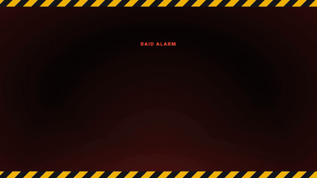

# RustPlusPlus Discord Bot Add-on

  

  
   
  🔊 <a href="docs/media/rustplusplus-raid.mp4">Watch the full video with sound</a>

A Home Assistant add-on for running the RustPlusPlus Discord bot, which connects to Rust game servers via the Rust+ Companion App — with native Home Assistant MQTT device integration.

---

> ## ⚠️ Facepunch removed event & vending machine data from Rust+ (6 August 2026)
>
> In the **Power Trip** update, Facepunch
> [stopped sending vending machine and event map markers (cargo, helis, travelling vendor) to Rust+](https://rust.facepunch.com/news/power-trip).
> This is a change on Facepunch's side that affects **every** Rust+ app and bot — it is not a bug in this
> add-on, and there is no version you can downgrade to that brings it back.
>
> **No longer working:** Cargo Ship / Patrol Helicopter / Chinook (CH47) / Oil Rig crate / Traveling
> Vendor / Deep Sea vendor notifications, the matching in-game and Discord commands, all vending
> machine features (`/market`, market subscriptions, the WebUI Shops Browser, Insta-Profit trades,
> shop pins on the live map) and event history/predictions in statistics.
>
> **Still working:** teammate tracking and the live map, team chat bridge, Smart Switches and groups,
> Smart Alarms, Storage Monitors and TC upkeep, cameras and drones, server info and time,
> BattleMetrics player tracking, all Home Assistant MQTT entities and Discord presence.
>
> Details, what is being done about it, and the possible workarounds:
> **[Announcement #48](https://github.com/KarlisKocins/homeassistant-addon-rustplusplus/issues/48)**

---

## About

RustPlusPlus is a powerful Discord bot that provides Quality-of-Life features for Rust players by integrating with the Rust+ Companion App. This add-on packages the bot for easy deployment on Home Assistant, with built-in MQTT discovery so your Rust smart devices appear as native Home Assistant entities.

### Features

- 🏠 **Home Assistant Integration**: Smart devices auto-discovered via MQTT — control switches, monitor alarms, and view storage directly from your HA dashboard
- 🚁 **Event Notifications**: _(unavailable since Rust Power Trip, see notice above)_ Get notified about Patrol Helicopter, Cargo Ship, Chinook 47, and Oil Rig events
- 🔌 **Smart Device Control**: Control Smart Switches and Smart Switch Groups via Discord, in-game chat, or Home Assistant
- 🚨 **Smart Alarms**: Set up alarms that notify you when triggered — also exposed as binary sensors in HA
- 📦 **Storage Monitoring**: Monitor Tool Cupboard upkeep and container contents — also exposed as sensors in HA
- 💬 **Team Communication**: Bridge Discord and in-game team chat
- 👥 **Player Tracking**: Track other teams using BattleMetrics integration (requires a BattleMetrics API key)
- 🎮 **Discord Bot Presence**: Bot status shows the connected server name and online teammate count
- 🛠️ **QoL Commands**: Extensive list of helpful commands for Discord and in-game use
- 🗺️ **WebUI**: Live map (teammate pins, events, shops with hover cards), Shops Browser and Insta-Profit trade finder with item icons, team statistics with an activity heatmap and player forecast, map replay
- 🔐 **Secured WebUI**: Password/token login on direct access, or open it from the Home Assistant sidebar (ingress) behind HA's own authentication

## Installation

### Step 1: Add the Repository

1. Navigate to **Settings** → **Add-ons** → **Add-on Store** in your Home Assistant
2. Click the **⋮** menu in the top right corner
3. Select **Repositories**
4. Add this repository URL: `https://github.com/KarlisKocins/homeassistant-addon-rustplusplus`
5. Click **Add**

### Step 2: Install the Add-on

1. Find "RustPlusPlus Discord Bot" in the add-on store
2. Click on it and press **Install**
3. Wait for the installation to complete

### Step 3: Configure the Add-on

1. Go to the **Configuration** tab
2. Fill in the required fields:
   - **Discord Client ID**: Your Discord application's client ID
   - **Discord Token**: Your Discord bot token
   - **Log Level**: Choose your preferred logging level (info recommended)
3. Optionally configure MQTT for Home Assistant integration (see [DOCS.md](DOCS.md#home-assistant-mqtt-integration))

### Step 4: Start the Add-on

1. Go to the **Info** tab
2. Click **Start**
3. Check the **Log** tab to ensure everything is running correctly

## Documentation

| Topic | Where |
|-------|-------|
| Configuration options, Discord bot and Rust+ credential setup | [DOCS.md](DOCS.md#configuration) |
| Player tracking (BattleMetrics API key) | [DOCS.md](DOCS.md#player-tracking) |
| Home Assistant MQTT integration, availability, raid alert blueprint | [DOCS.md](DOCS.md#home-assistant-mqtt-integration) |
| WebUI and statistics | [DOCS.md](DOCS.md#webui--statistics) |
| Troubleshooting | [DOCS.md](DOCS.md#troubleshooting) |
| Step-by-step installation walkthrough | [docs/installation.md](docs/installation.md) |
| Maintaining and releasing | [docs/maintaining.md](docs/maintaining.md) |
| Changelog | [CHANGELOG.md](CHANGELOG.md) |

## Support

- [Official RustPlusPlus documentation](https://github.com/alexemanuelol/rustplusplus/blob/master/docs/documentation.md)
- [Discord support server](https://discord.gg/vcrKbKVAbc)
- [GitHub Issues](https://github.com/KarlisKocins/homeassistant-addon-rustplusplus/issues)

## Contributing

See [CONTRIBUTING.md](CONTRIBUTING.md). Security issues: [SECURITY.md](SECURITY.md).

## License

Licensed under the [GNU GPL v3.0](LICENSE). This add-on is based on
[RustPlusPlus](https://github.com/alexemanuelol/rustplusplus) by Alexander Emanuelsson (alexemanuelol).
